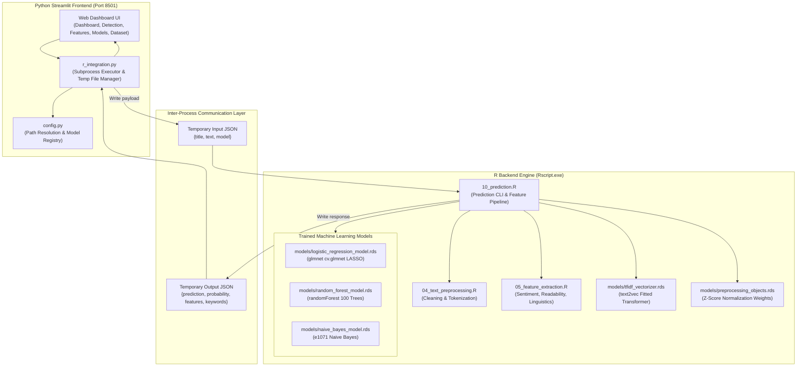
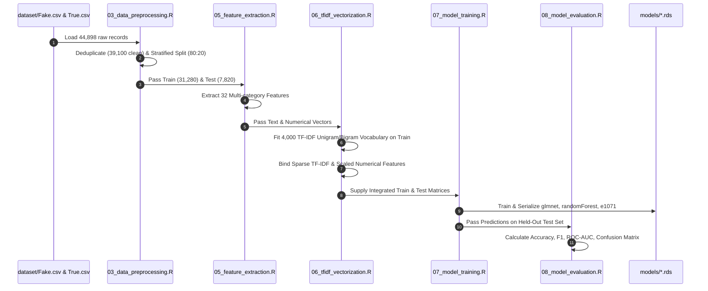
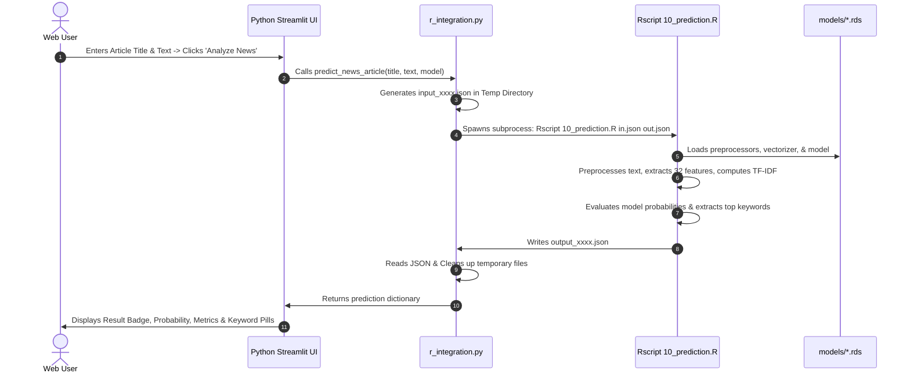

# System Architecture: Multi-Feature Fake News Detection

This document specifies the technical architecture, component responsibilities, inter-process communication protocol, and data flows of the system.

---

## 1. Architectural Overview

The system employs a decoupled, polyglot architecture:
- **Backend & Compute Engine:** R Programming Language (v4.6.1)
- **Frontend & Presentation Layer:** Python (v3.14) + Streamlit (v1.58)
- **IPC Protocol:** Standard Subprocess Execution with File-Based JSON Data Exchange

---

## 2. Component Responsibilities

### A. R Language Responsibilities (The Brain)
1. **Data Preprocessing:** Cleaning raw text, stripping publisher tags, eliminating duplicates, and performing stratified sampling.
2. **Feature Extraction:** Lexicon sentiment matching, syllable and sentence counting, uppercase/punctuation extraction, and statistical summarization.
3. **TF-IDF Transformation:** Constructing sparse document-term matrices using `text2vec`.
4. **Machine Learning Model Training:** Model optimization with cross-validation using `glmnet`, `randomForest`, and `e1071`.
5. **Model Evaluation:** Computing Accuracy, Precision, Recall, F1-Score, and ROC-AUC on held-out test data.
6. **Inference Execution:** Standardized prediction CLI (`10_prediction.R`) executing all preprocessing and model scoring identically to training.

### B. Python Streamlit Responsibilities (The Face)
1. **User Interface:** Delivering an interactive, responsive dashboard.
2. **User Input Handling:** Capturing news headlines and articles, validating inputs, and offering preset demonstration samples.
3. **Process Orchestration:** Locating the `Rscript.exe` executable, spawning isolated subprocesses, and safely writing/reading temporary JSON files.
4. **Data Visualization:** Rendering Plotly interactive bar charts, donut charts, gauge meters, and confusion matrices.
5. **Cross-Page State Management:** Persisting inference results in `st.session_state` so users can seamlessly inspect features across tabs.

---

## 3. Data Flow Pipelines

### A. Model Training Flow (Offline Execution)

### B. Live Inference Flow (Real-Time Prediction)

---

## 4. Security and Isolation Principles
1. **Isolated File Names:** Temporary files use high-resolution timestamps and process IDs (`fakenews_<timestamp>_<pid>_in.json`) to prevent collisions during concurrent requests.
2. **Automatic Cleanup:** Temporary files are safely deleted in Python `finally:` blocks even if errors occur.
3. **Execution Timeouts:** Subprocess calls enforce a strict 45-second execution timeout to prevent runaway processes.
4. **Sandboxed Library Loading:** Local dependencies are isolated in `r_libs/`, ensuring execution succeeds in restricted sandbox and enterprise environments.
